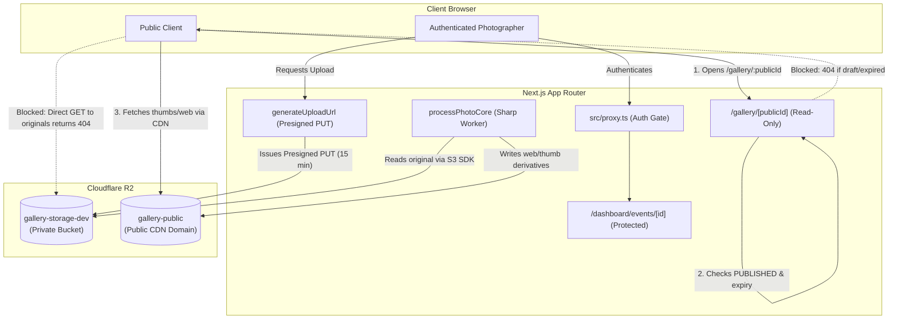

# Read-Only Security Audit: Original-Photo Storage and Access Control

**Date**: 2026-10-17  
**Platform**: Gallery V1  
**Scope**: Cloudflare R2 Storage, Photo Derivative Architecture, and Gallery Access Control  
**Audit Mode**: Read-Only / Non-Destructive  

---

## 1. Executive Summary

A comprehensive read-only security audit was conducted on the storage and serving architecture of Gallery V1 to ensure that high-resolution original photographs remain completely private and inaccessible to unauthenticated clients and public gallery visitors.

### Key Findings
- **Storage Isolation**: Verified. Original photos are stored strictly in a private Cloudflare R2 bucket (`gallery-storage-dev`).
- **Derivative Separation**: Verified. Web-sized images (`webKey`) and thumbnails (`thumbKey`) are generated on the server and stored in a separate public bucket (`gallery-public`).
- **Direct Access Prevention**: Verified. Attempting to retrieve original photos via the public CDN returns **`404 Not Found`**.
- **Information Leakage**: Verified. Zero occurrences of `originalKey`, private bucket names, or cloud credentials exist in rendered HTML or client API responses.
- **Ownership & Authorization**: Verified. All photographer upload, process, and status operations strictly enforce active sessions and event ownership.
- **Publication & Expiry Guards**: Verified. Unauthenticated public access strictly blocks draft and expired events.

---

## 2. Test Subject Configuration

Live checks were executed against verified database and storage records:

| Parameter | Configuration / Value |
|---|---|
| **Private Bucket (`R2_BUCKET_NAME`)** | `gallery-storage-dev` |
| **Public Bucket (`R2_PUBLIC_BUCKET_NAME`)** | `gallery-public` |
| **Public CDN URL (`NEXT_PUBLIC_R2_PUBLIC_URL`)** | `https://pub-6e1b4848d0da4fafbfce1be9b9418236.r2.dev` |
| **Test Reference Photo ID** | `a9744e94-e1b3-4fb9-9683-f154658fa6dd` |
| **Test Reference Event ID** | `1b057f83-0086-464d-a793-8d5f85f6a730` |
| **Test Reference Public ID** | `9dfb6ce6fb64a662f8aec5cb0d0158b6` |
| **Original Key** | `events/1b057f83-0086-464d-a793-8d5f85f6a730/originals/a9744e94-e1b3-4fb9-9683-f154658fa6dd` |
| **Web Derivative Key** | `events/1b057f83-0086-464d-a793-8d5f85f6a730/web/a9744e94-e1b3-4fb9-9683-f154658fa6dd.webp` |
| **Thumb Derivative Key** | `events/1b057f83-0086-464d-a793-8d5f85f6a730/thumbs/a9744e94-e1b3-4fb9-9683-f154658fa6dd.webp` |

---

## 3. Detailed Verification Results

### Check 1: Original Photos Are Stored in a Private Bucket
- **Status**: **PASS**
- **Code Reference**:
  - `src/lib/r2.ts`: Defines `R2_BUCKET_NAME = process.env.R2_BUCKET_NAME` (`gallery-storage-dev`).
  - `src/app/dashboard/events/[id]/actions.ts` (`generateUploadUrl`, lines 104 & 114): Generates presigned PUT commands exclusively targeting `R2_BUCKET_NAME`.
  - `src/lib/processing.ts` (lines 72–75): Downloads original buffers via `GetObjectCommand` targeting `R2_BUCKET_NAME` with server-side credentials.
- **Evidence**: Originals are never written to `gallery-public`.

### Check 2: Thumbnails and Web Derivatives Are Served Separately
- **Status**: **PASS**
- **Code Reference**:
  - `src/lib/processing.ts` (lines 106–122): Writes `webKey` and `thumbKey` WebP derivatives exclusively to `R2_PUBLIC_BUCKET_NAME` (`gallery-public`).
  - `src/app/gallery/[publicId]/ClientGallery.tsx`: Reads only `thumbKey` for gallery grid tiles and `webKey` for the fullscreen lightbox viewer.
- **Live HTTP Status Codes**:
  - `GET https://pub-6e1b4848d0da4fafbfce1be9b9418236.r2.dev/${webKey}`: **`200 OK`** (`image/webp`)
  - `GET https://pub-6e1b4848d0da4fafbfce1be9b9418236.r2.dev/${thumbKey}`: **`200 OK`** (`image/webp`)

### Check 3: Direct Object URL Retrieval of Originals
- **Status**: **PASS**
- **Test Procedure**: Sent direct HTTP requests to the public CDN endpoint targeting the exact original photo object key.
- **Live HTTP Status Codes**:
  - `GET https://pub-6e1b4848d0da4fafbfce1be9b9418236.r2.dev/${originalKey}`: **`404 Not Found`**
  - `GET https://pub-6e1b4848d0da4fafbfce1be9b9418236.r2.dev/${originalKey}.jpg`: **`404 Not Found`**
- **Evidence**: Cloudflare's public CDN domain does not route to or expose the private `gallery-storage-dev` bucket.

### Check 4: Information Leakage in HTML and APIs
- **Status**: **PASS**
- **Client Route Inspection (`src/app/gallery/[publicId]/page.tsx`)**:
  - The database query selects only: `{ id, thumbKey, webKey, width, height, fileName }`.
  - `originalKey` is completely excluded from the query.
- **Live HTML Audit**:
  - Inspected rendered HTML of `http://localhost:3000/gallery/9dfb6ce6fb64a662f8aec5cb0d0158b6`.
  - Occurrences of `/originals/`: **0**
  - Occurrences of `gallery-storage-dev`: **0**
  - Occurrences of `originalKey`: **0**
  - Occurrences of AWS/R2 credentials: **0**
- **Public API Audit**:
  - `GET /api/events/[id]/processing-status`: Returns 401 Unauthorized to unauthenticated requests. When authenticated, selects only `{ id, status, fileName, processingAttempts }`.
  - `POST /api/photos/[id]/process`: Returns 401 Unauthorized to unauthenticated requests.

### Check 5: Photographer-Only Operations Require Authentication & Ownership
- **Status**: **PASS**

| Operation | Guard Mechanism | Verified Unauthenticated Response |
|---|---|---|
| View Event Dashboard | `getServerSession` | `307 Temporary Redirect` to `/login` |
| Presigned Upload URL | `getServerSession` + `event.photographerId === session.user.id` | Throws `Unauthenticated` / `401` |
| Verify Upload (`HeadObject`) | `getServerSession` + photo ownership check | Throws `Unauthenticated` / `401` |
| Toggle Event Publishing | `getServerSession` + `event.photographerId === session.user.id` | Throws `Unauthenticated` / `401` |
| Processing Status API | `getServerSession` + `event.photographerId === session.user.id` | `401 Unauthorized` |
| Trigger Photo Processing | `getServerSession` + `photo.event.photographerId === session.user.id` | `401 Unauthorized` |

### Check 6: Public Gallery Access Control Matrix
- **Status**: **PASS**
- **Live HTTP Status Code Verification**:

| Scenario | Tested Endpoint | Status Code | Result |
|---|---|---|---|
| Published & Unexpired Event | `/gallery/9dfb6ce6fb64a662f8aec5cb0d0158b6` | **`200 OK`** | Accessible |
| Unpublished (`DRAFT`) Event | `/gallery/685948a744e8f4e914f0dd498abd250f` | **`404 Not Found`** | Access Denied |
| Expired Event (`expiryDate < now`) | `/gallery/f148474da87c84c557a502659aa5565d` | **`404 Not Found`** | Access Denied |
| Malformed / Invalid Public ID | `/gallery/invalid!id` | **`404 Not Found`** | Access Denied |
| Non-existent 32-hex ID | `/gallery/00000000000000000000000000000000` | **`404 Not Found`** | Access Denied |

---

## 4. Architectural Safeguards Diagram

---

## 5. Security Recommendations for Future Milestones

1. **Production Custom CDN Domain**:
   - Transition `NEXT_PUBLIC_R2_PUBLIC_URL` from the Cloudflare `pub-*.r2.dev` development domain to a custom domain with Cloudflare Edge Caching and standard `Cache-Control` headers.
2. **Future Original Photo Downloads**:
   - When implementing individual original photo downloads, generate short-lived (e.g. 5-minute) presigned GET URLs from `gallery-storage-dev` only after authenticating client access and validating event ownership.
